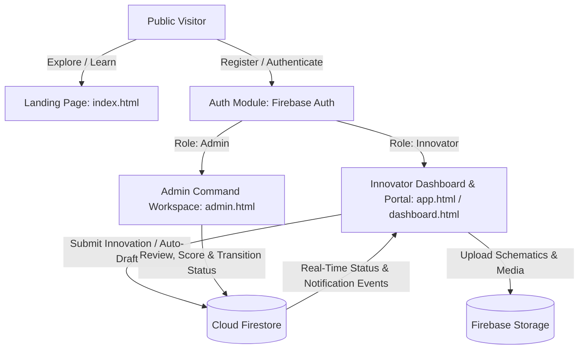

# DICON Grassroots Innovations Talent Hunt (GITH)

[](#)
[](#)
[](#)
[](#)

A digital platform powered by the **Defence Industries Corporation of Nigeria (DICON)** to discover, evaluate, mentor, and accelerate indigenous grassroots technological and industrial innovations.

---

## 📌 Table of Contents

- [Overview](#overview)
- [Key Features](#key-features)
- [Application Architecture](#application-architecture)
- [Project Structure](#project-structure)
- [Getting Started](#getting-started)
  - [Prerequisites](#prerequisites)
  - [Installation & Local Run](#installation--local-run)
  - [Firebase Configuration](#firebase-configuration)
- [User Roles & Portals](#user-roles--portals)
- [Security & Rules](#security--rules)
- [Deployment](#deployment)
- [Contributing & Maintenance](#contributing--maintenance)

---

## 🌟 Overview

The **DICON Grassroots Innovations Talent Hunt (GITH)** is an initiative aimed at tapping into Nigeria's creative and inventive talent pool. This platform bridges inventors, technicians, and local creators directly with defence, industrial, and national technology ecosystems through a transparent, multi-stage submission, vetting, and incubation pipeline.

---

## ✨ Key Features

### 🏛️ Editorial & Public Landing Portal
- **Modern Institutional UI**: Tailored with institutional colors (Deep Emerald & Gold) and crisp typography.
- **Program Roadmap & Guidelines**: Clear eligibility criteria, submission stages, and interactive FAQ sections.
- **Deep-Linked Portals**: Direct routing into Innovator Registration, Login, and Status Inquiries.

### 🚀 Innovator Experience
- **Multi-Step Innovation Submission Engine**: Guided 6-step form with live validation, client-side draft auto-saving, and IP declaration.
- **Real-Time Application Tracking**: Visual milestone timeline reflecting current evaluation stages (*Screening &rarr; Verification &rarr; Assessment &rarr; Shortlisted &rarr; Selected &rarr; Mentorship &rarr; Incubation*).
- **Profile & Skill Management**: Dynamic profile completion score calculation and inventor asset management.
- **Notification Center**: In-app notifications alerting inventors on status updates, feedback, and milestone changes.

### 🛡️ Administrative Command Center
- **Role-Based Access Control (RBAC)**: Secure access restricted to verified administrative staff.
- **Live Pipeline Analytics**: Real-time metrics tracking submissions, reviewed items, and category distributions.
- **Application Review Workflow**: Detailed submission inspector, status transitions, evaluation notes, and accessible toast/modal notifications.

---

## 🏗️ Application Architecture



---

## 📂 Project Structure

```text
DICON_Git/
├── assets/                  # Brand assets, imagery, and official logos
│   ├── logo.png             # Official DICON GITH emblem
│   └── *.jpg                # Program thematic imagery
├── css/                     # Vanilla CSS design system & stylesheets
│   ├── styles.css           # Global typography, color tokens, and components
│   └── admin.css            # Specialized styling for admin dashboard
├── js/                      # Frontend application logic & integrations
│   ├── firebase-config.js   # Firebase client SDK initialization & credentials
│   ├── app.js               # Submission wizard, state management, tracking logic
│   ├── admin.js             # Admin analytics, reviews, and status workflows
│   └── data.js              # Reference metadata, categories, and state lists
├── admin.html               # Administrator command center
├── app.html                 # Complete mobile-ready PWA / innovator shell
├── dashboard.html           # Innovator desktop overview dashboard
├── index.html               # Public editorial landing page
├── login.html               # Secure authentication portal
├── register.html            # Innovator account registration
├── forgot-password.html     # Self-service password recovery
├── server.js                # Lightweight zero-dependency development server
├── package.json             # Project metadata and launch scripts
├── firebase.json            # Firebase hosting and emulator configuration
├── firestore.rules          # Granular Cloud Firestore security rules
└── storage.rules            # Firebase Storage security rules
```

---

## 🚀 Getting Started

### Prerequisites

- [Node.js](https://nodejs.org/) (v16.0.0 or later recommended)
- Modern web browser (Chrome, Edge, Firefox, or Safari)
- Optional: [Firebase CLI](https://firebase.google.com/docs/cli) (`npm install -g firebase-tools`)

### Installation & Local Run

1. **Clone the repository**:
   ```bash
   git clone https://github.com/frankd3u9d39/DICON_Git.git
   cd DICON_Git
   ```

2. **Start the local server**:
   ```bash
   npm start
   ```
   *Alternatively:*
   ```bash
   node server.js
   ```

3. **Open the application**:
   Open [http://localhost:3000](http://localhost:3000) in your web browser.

---

## 🔑 Firebase Configuration

The application interfaces directly with Firebase for Authentication, Cloud Firestore, and Storage.

Configuration is defined in [js/firebase-config.js](js/firebase-config.js):

```javascript
const firebaseConfig = {
  apiKey: "...",
  authDomain: "...",
  projectId: "...",
  storageBucket: "...",
  messagingSenderId: "...",
  appId: "..."
};
```

> [!NOTE]
> Ensure that your Firebase project has **Email/Password** authentication enabled and that the corresponding Firestore database has been created in your designated region.

---

## 👥 User Roles & Portals

| Route | Target Audience | Primary Function |
|---|---|---|
| `/index.html` | Public | Overview of DICON GITH, eligibility, and announcements |
| `/register.html` | Public Innovators | Account registration with automatic `innovator` role assignment |
| `/login.html` | All Users | Unified sign-in routing users according to their RBAC role |
| `/dashboard.html` / `/app.html` | Innovators | Multi-step submission wizard, draft recovery, and live progress timeline |
| `/admin.html` | Program Evaluators / Admins | Pipeline analytics, application auditing, and stage decisioning |

---

## 🔒 Security & Rules

- **Firestore Rules (`firestore.rules`)**:
  - Enforces that innovators can only view, create, and update their own submissions and profile records.
  - Prevents non-admin accounts from modifying application review statuses, scores, or role attributes.
- **Storage Rules (`storage.rules`)**:
  - Restricts document/media uploads to authenticated users with size limits and MIME-type restrictions.

---

## 🌐 Deployment

### Deploying to Firebase Hosting

1. Authenticate with your Firebase account:
   ```bash
   firebase login
   ```
2. Initialize and deploy:
   ```bash
   firebase deploy
   ```
3. To deploy specific services only:
   ```bash
   firebase deploy --only hosting
   firebase deploy --only firestore:rules
   firebase deploy --only storage
   ```

---

## 📄 License

This software and related documentation are proprietary to the **Defence Industries Corporation of Nigeria (DICON)**. All rights reserved.
